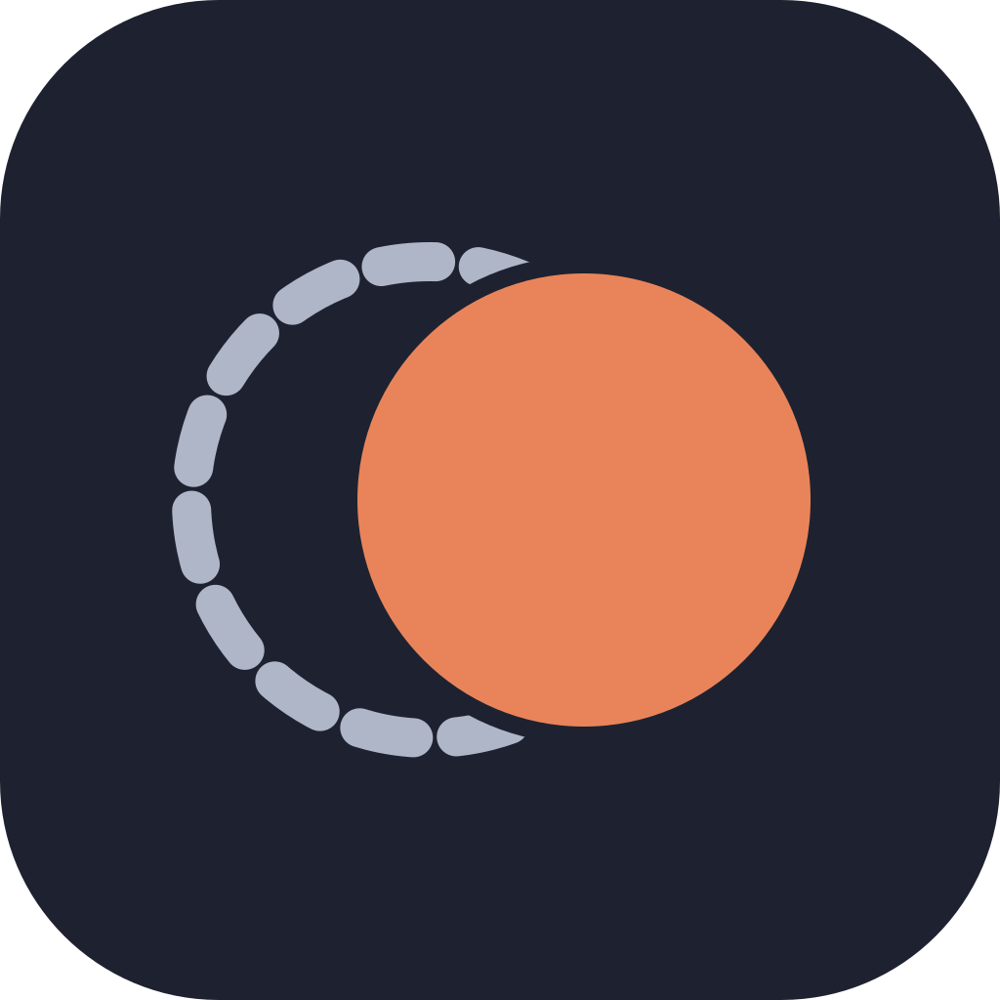

<p align="center">
  
</p>

<h1 align="center">Locum</h1>

<p align="center">
  Claude Code subagents, and the main session, on DeepSeek, Qwen, GLM, Kimi and MiniMax models.
</p>

<p align="center">
  <a href="https://github.com/asharahmed/claude-locum/actions/workflows/check.yml"></a>
  <a href="https://github.com/asharahmed/claude-locum/releases/latest"></a>
  <a href="LICENSE"></a>
  <a href="https://code.claude.com"></a>
</p>

---

A *locum tenens* is a doctor who covers for another, in the same practice, with the same patients and records. Locum does that for Claude in Claude Code. Its agents are native subagents: they use Claude Code's tools, permission rules, transcripts and subagent view. The only difference is the model, reached through [OpenRouter](https://openrouter.ai) or the lab's own API.

Your Claude login and model stay the default. Hand work to a Locum agent when you want a cheaper model or a second opinion from another model family. You can also move the whole session to another model for a while.

```text
> have kimi review the error handling in hooks/openrouter.ts
> run the cheap agent on the test failures
> /model deepseek/deepseek-v4.1-flash-1017
```

## Contents

- [Quick start](#quick-start)
- [Agents](#agents)
- [Switching the main session](#switching-the-main-session)
- [The /locum command](#the-locum-command)
- [Keys and direct providers](#keys-and-direct-providers)
- [Settings](#settings)
- [Cost and reliability](#cost-and-reliability)
- [Auto mode](#auto-mode)
- [Safety and limits](#safety-and-limits)
- [Troubleshooting](#troubleshooting)
- [Development](#development)

## Quick start

1. Add the marketplace and install the plugin:

   ```sh
   claude plugin marketplace add asharahmed/claude-locum
   claude plugin install locum@ashar-local --scope user
   ```

2. Claude Code opens the plugin's settings. Paste an [OpenRouter API key](https://openrouter.ai/settings/keys) with a few dollars of credit into the first field and leave the rest as they are. Claude Code keeps the key in your system keychain.

3. Start a session, or run `/reload-plugins` in an open one, and ask for an agent:

   ```text
   > have the deepseek agent write tests for parser.py
   ```

Run `/locum setup` to see which keys are set, and `/locum` for your balance, agents and spend. To change a key later, run `/plugin configure locum@ashar-local`.

## Agents

| Agent | Default model | Good for |
| --- | --- | --- |
| `locum:deepseek` | DeepSeek V4.1 Flash 1017 | Coding, research and multi-step tasks. The default. |
| `locum:minimax` | MiniMax M3.1 Flash | Agentic coding at DeepSeek's price. |
| `locum:qwen` | Qwen 3.8 Flash | Cheap work that involves images. Needs an Alibaba key under the default privacy setting. |
| `locum:glm` | GLM-5.3 | Design and planning. |
| `locum:kimi` | Kimi K3 | A second opinion from another model family. |
| `locum:cheap` | DeepSeek V4 Flash 0731 | Tests and simple tasks, at about $0.04 per million input tokens. |
| `locum:custom` | Any OpenRouter model you set | Trying a model out. |

Each agent is a native subagent. The Agent tool starts it, and its tool calls go through Claude Code's own tools and permission rules. Its transcript opens from the tasks list and names the real model. It receives what a native subagent's request carries: the environment and date, `CLAUDE.md` when the agent gets it, the native subagent tool set, and its reasoning, streamed live.

You can change any agent's model and reasoning effort in [Settings](#settings) or with `/locum use`. `/locum models` lists alternatives.

## Switching the main session

`/model <openrouter-id>` moves the main session to that model, and `/model opus` moves it back. Locum answers every request of a session whose model ID contains a `/`.

The model gets Claude Code's own system prompt, with the identity line naming the real model, and every built-in tool. Compaction runs on the same model.

<details>
<summary>Adding a model to the <code>/model</code> picker, and keeping Claude as the default</summary>

<br>

One extra model can appear in the picker. Set these in the `env` block of `~/.claude/settings.json`:

```json
{
  "env": {
    "ANTHROPIC_CUSTOM_MODEL_OPTION": "deepseek/deepseek-v4.1-flash-1017",
    "ANTHROPIC_CUSTOM_MODEL_OPTION_NAME": "DeepSeek V4.1 Flash (Locum)",
    "ANTHROPIC_CUSTOM_MODEL_OPTION_DESCRIPTION": "Answered by the Locum plugin",
    "ANTHROPIC_CUSTOM_MODEL_OPTION_SUPPORTED_CAPABILITIES": "effort,thinking",
    "ANTHROPIC_MODEL": "opus"
  }
}
```

Picking a model in `/model` saves it as your default. `ANTHROPIC_MODEL` outranks that saved choice at every launch, so new sessions start on Claude while `/model` still switches the session you're in. Pressing `s` in the picker applies a choice to the current session only.

In a switched session, Claude Code may run its built-in subagents (general-purpose, Explore) on a Claude model of its choosing. A subagent that inherits the switched model is answered by Locum.

</details>

## The /locum command

| Command | Shows or does |
| --- | --- |
| `/locum` | Balance, keys, each agent's model and route, settings, spend history across sessions, model health and this session's runs. |
| `/locum setup` | Which keys are set, where to get the others, and how to add them. |
| `/locum models [search]` | Tool-capable OpenRouter models, cheapest first, with price, context size, image support and reasoning. |
| `/locum use <agent> <model>` | Moves an agent to another model after `/reload-plugins`. The choice is kept across sessions until `/locum use <agent> default`. |
| `/locum help` | This list. |

## Keys and direct providers

An OpenRouter key runs every agent. OpenRouter charges each lab's own per-token price and adds a 5.5% fee when you buy credit.

A lab's own key sends that lab's models straight to it, with OpenRouter as the backup. Each key has a field in `/plugin configure locum@ashar-local`, and nothing else needs setting.

| Key | Models | Is it worth adding? |
| --- | --- | --- |
| DeepSeek | DeepSeek V4.1 Flash, V4 Pro | Yes. It avoids the 5.5% fee. |
| Alibaba Model Studio | Qwen 3.8 Flash, Qwen 3.8 Max | Yes, for `locum:qwen`. OpenRouter has no zero-retention host for Qwen, so under the default privacy setting Qwen runs only with this key. |
| MiniMax | MiniMax M3.1 Flash | Yes. It avoids the 5.5% fee. |
| Z.ai | GLM-5.3, GLM-5.3 Flash | Only with a GLM Coding Plan. Per token, other OpenRouter hosts serve GLM-5.3 for less: $0.08/$1.40 per million at Wafer against $1.40/$4.40 at Z.ai in October 2026. |

How direct calls behave:

- Alibaba, MiniMax and Z.ai keys belong to one region. Locum tries the lab's regional endpoints until one accepts the key, then keeps using it. A workspace-dedicated Alibaba URL goes in `dashscopeBaseUrl`.
- A failed direct request is retried through OpenRouter on the same model. A key that a lab refuses everywhere gets one notice, and Locum stops using it for the rest of the session.
- Without an OpenRouter key, the models of labs you have keys for still run. The other agents report which key to add.
- The `privacy` setting filters OpenRouter's providers only. A direct call is covered by the lab's own data terms. Set `direct` to `off` to send everything through OpenRouter.
- Direct APIs don't report cost, so Locum prices those calls from the labs' published rates, including DeepSeek's doubled peak-hour prices. The spend caps apply as usual.

Keys can also come from the environment for any field left empty: `OPENROUTER_API_KEY`, `DEEPSEEK_API_KEY`, `DASHSCOPE_API_KEY`, `MINIMAX_API_KEY` and `ZAI_API_KEY`. To store a key from a terminal without it reaching your shell history:

```sh
read -rs K && printf '{"deepseekApiKey":"%s"}' "$K" \
  | claude plugin configure locum@ashar-local --values-stdin; unset K
```

## Settings

Open them with `/plugin configure locum@ashar-local`.

| Option | Default | Effect |
| --- | --- | --- |
| API keys | empty | OpenRouter, DeepSeek, Alibaba, MiniMax and Z.ai. Stored in the keychain. |
| `privacy` | `zero-retention` | Which OpenRouter providers may serve requests: `zero-retention`, `no-data-collection` or `off`. |
| `direct` | `auto` | `auto` sends a model to its lab when you have that lab's key. `off` sends everything through OpenRouter. |
| `maxRunUsd` | `0.5` | A run stops once it has spent this much. `0` turns the cap off. |
| `maxSessionUsd` | `3` | New agents are refused, and running ones stop, once a session has spent this much. `0` turns the cap off. |
| `fallbackModel` | DeepSeek V4 Flash 0731 | A step whose model keeps failing is retried once on this model. It is never a Claude model. |
| `autoMode` | `refuse` | Whether Locum runs in auto mode. See [Auto mode](#auto-mode). |
| `lowBalanceUsd` | `5` | Shows a notice at session start when the OpenRouter balance is below this. |
| `<agent>Model`, `<agent>Effort` | per agent | Each agent's model, and its reasoning effort when the Agent call names none. |
| `customModel`, `customLabel`, `customEffort` | empty | Setting `customModel` enables `locum:custom`. |
| `dashscopeBaseUrl` | empty | Only for a workspace-dedicated Alibaba URL. |

Agents send your files and command output to the model's provider. Choose `privacy` and your keys with that in mind.

## Cost and reliability

- With the default models, each agent is pinned to its cheapest zero-retention OpenRouter providers, with the others kept as a fallback. Prompts are marked for caching, so a cached step costs a fraction of a fresh one.
- Costs come from OpenRouter's reports. When a reply has none, Locum estimates the cost from token counts at listed prices, so the caps still hold.
- Retryable errors are retried. After three failed steps in a row, a model is skipped for two minutes and its steps go straight to the fallback model.
- Model capabilities come from OpenRouter's model list. A model without reasoning gets no thinking budget. A model without tool calls, or an unknown model ID, fails with a clear message.
- Claude Code's own cost summary doesn't include Locum's spend. `/locum` and each run's closing line do.

## Auto mode

Auto mode's safety check runs on Anthropic's servers against Anthropic's responses, so it refuses every tool call that another model makes. With `autoMode: refuse`, the default, Locum agents don't start in auto mode.

With `autoMode: allow`, those actions run without the check's review. Your deny rules, `permissions.ask` rules, other plugins' and hooks' asks, and admin limits all still apply.

<details>
<summary>How reports are delivered in auto mode</summary>

<br>

SubagentHandback accepts only the auto mode check's approval, so in auto mode an agent ends with a plain-text report, and Locum delivers it in the completion notice. The report carries the label "Auto mode did not review this report or the work behind it", followed by the tool calls the agent made. Its `<` characters are escaped so it can't forge markup around that label. An agent that reports without making any tool call is asked once to do the work. SendMessage is refused, so the labelled report is the only route results take back to you.

The permission mode is read from Claude Code's hook events. After Shift+Tab mid-turn, the next tool call may still see the old mode.

</details>

## Safety and limits

- Locum never falls back to your Claude model. If its own code fails during a step, the step ends with an error.
- A path refused to Write, Edit, NotebookEdit or Read is also refused to Bash commands that name it. This is best-effort: a path built from a variable, a glob or a script isn't caught, and the main session isn't covered.
- API keys reach `curl` through its environment, never its command line.
- MCP tools can't be used, because only Anthropic's API expands ToolSearch's tool references. The model is told when a tool it loaded is unavailable.
- Images go to models that read them. Other models get a note in their place, and PDFs become a note for every model.
- The line under the Claude Code logo keeps naming the session's model. The band above the prompt names the model actually answering.

**Requirements:** Claude Code 2.1.309 or later with the function-hooks plugin API (tested on 2.1.309 and 2.1.310), plus `curl` and `python3` on the PATH.

## Troubleshooting

| Message | Cause | Fix |
| --- | --- | --- |
| `Agent type 'locum:…' not found` | The session loaded Locum before that agent existed. | Run `/reload-plugins`. |
| `no OpenRouter key` | No key is set in the plugin settings or the environment. | Run `/locum setup`. |
| `… refused its API key` | A lab rejected the key you entered for it. | Correct it in `/plugin configure locum@ashar-local`. |
| `… can't run in auto mode` | `autoMode` is `refuse`. | Switch to manual or accept-edits with Shift+Tab, or set `autoMode` to `allow`. |
| `the OpenRouter balance is too low` | The balance can't cover the request, or several requests arrived together. | [Top up](https://openrouter.ai/settings/credits), or run fewer agents at once. |
| `no OpenRouter provider of … meets the privacy setting` | No provider of that model qualifies under `privacy`. | Choose another model with `/locum models`, add the lab's key, or loosen `privacy`. |
| `… doesn't support tool calls` | The model can't call tools, or the ID is wrong. | Find a tool-capable ID with `/locum models <name>`. |
| `this run reached the … spend cap` | `maxRunUsd` or `maxSessionUsd` was reached. | Raise the cap if the spend is expected. |
| New sessions start on another model | Picking a model in `/model` saved it as the default. | Set `ANTHROPIC_MODEL` as shown in [Switching the main session](#switching-the-main-session). |

To check that nothing reaches Anthropic, start Claude Code with `--debug-file /tmp/d.log` and search for `dispatching to firstParty`. A line preceded by `cc_is_subagent=true` is a subagent step sent to Anthropic. There should be none for Locum's agents.

## Development

```text
hooks/
  register.tsx   hook wiring
  agents.ts      agents and settings
  providers.ts   direct providers: endpoints, model IDs, prices
  openrouter.ts  streaming client
  messages.ts    what the model is sent
  commands.ts    /locum, the spend ledger and model choices
  guard.ts       path guard
  state.ts       run state
  schemas.ts     generated tool schemas
tests/           61 tests on recorded streams; they spend nothing
scripts/
  check.sh            validate, type-check and test
  live-regression.sh  14 scenarios against the real APIs, a few cents a run
  gen-schemas.py      regenerate schemas.ts after a Claude Code update
assets/          icon and social preview sources
```

- `scripts/check.sh` exits non-zero on any failure. GitHub Actions runs it on every push and pull request, without the type-check, because Claude Code's plugin type file isn't published.
- Run `scripts/live-regression.sh` before a release. It reruns the code the agents wrote and checks that no step went to Anthropic.
- To update, run `claude plugin marketplace update ashar-local`, then `/reload-plugins`.
- To turn Locum off, run `claude plugin disable locum@ashar-local`. To remove it, run `claude plugin uninstall locum@ashar-local`.

See [CHANGELOG.md](CHANGELOG.md) for release history.

## License

MIT. See [LICENSE](LICENSE). Report security issues as described in [SECURITY.md](SECURITY.md).
